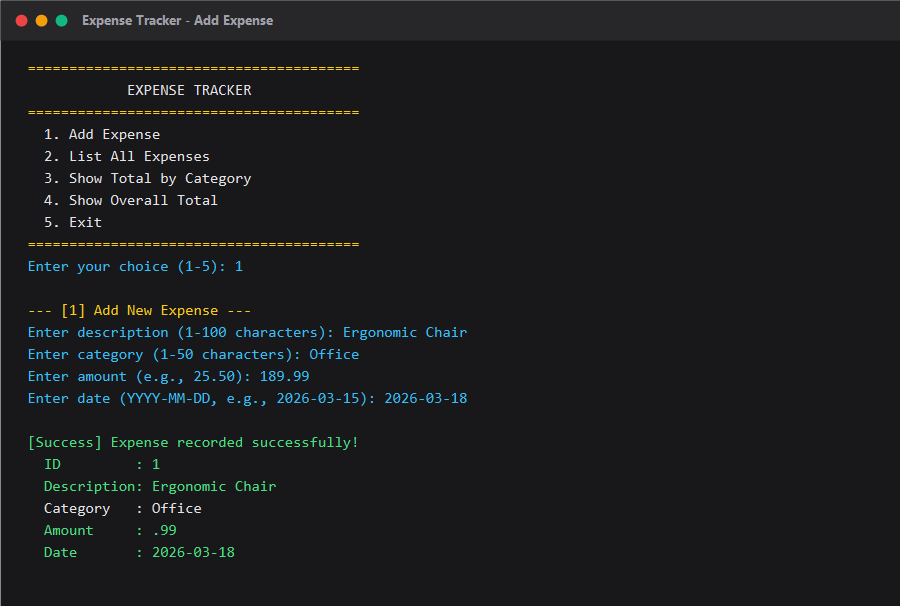
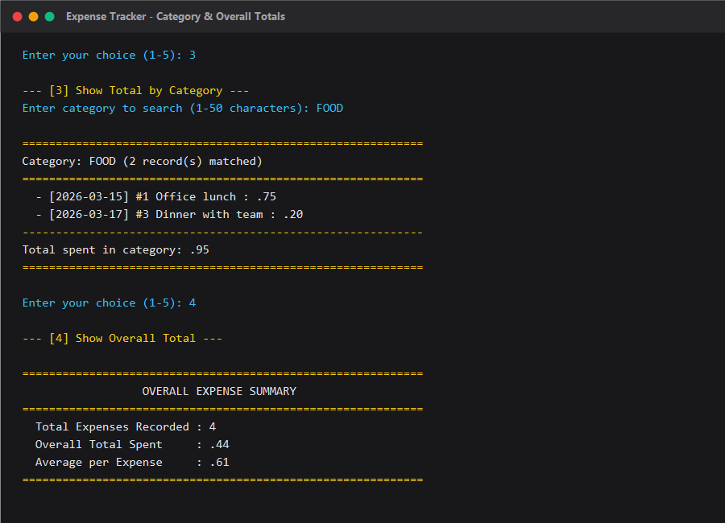
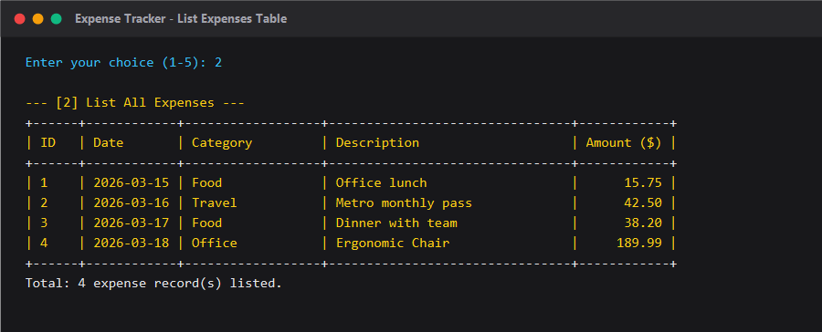
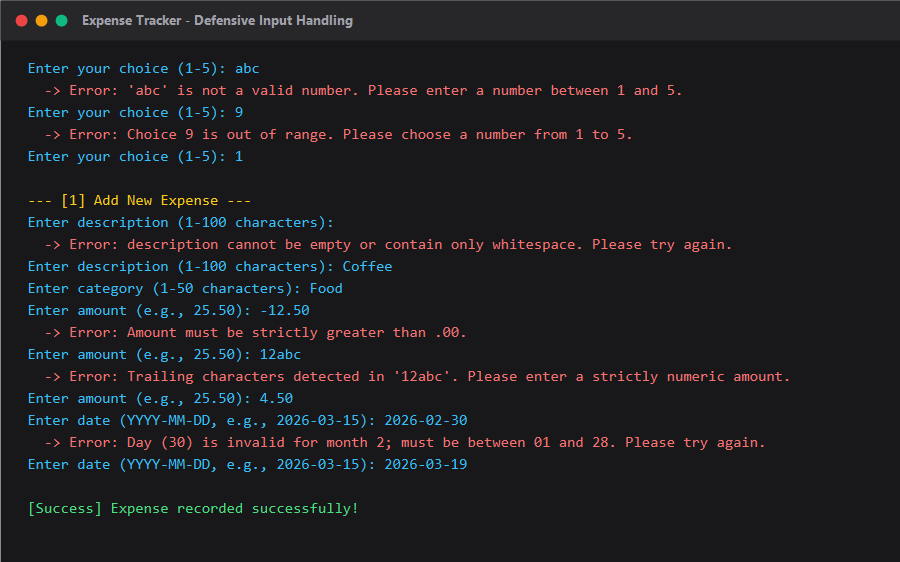

# Object-Oriented Library Manager (C++17)

A robust, beginner-friendly, multi-file **Library Management System** built with **modern C++17** using only the C++ Standard Library. The project demonstrates core Object-Oriented Programming (OOP) principles—encapsulation, single-responsibility, data integrity, and RAII-based safe persistence.

---

## Table of Contents

- [What the Project Does](#what-the-project-does)
- [Architecture & Design](#architecture--design)
  - [Classes & Responsibilities](#classes--responsibilities)
  - [Ownership & RAII Model](#ownership--raii-model)
  - [Class Diagram Link](#class-diagram-link)
- [CSV Format & Safe Persistence](#csv-format--safe-persistence)
  - [Exact Seed Schema](#exact-seed-schema)
  - [Atomic Write & Crash Resilience](#atomic-write--crash-resilience)
  - [Defensive Load & Error Recovery](#defensive-load--error-recovery)
- [Build and Run Instructions](#build-and-run-instructions)
  - [Prerequisites](#prerequisites)
  - [Option A: Direct g++ Compilation](#option-a-direct-g-compilation)
  - [Option B: CMake Build](#option-b-cmake-build)
- [Running Automated Tests](#running-automated-tests)
- [Menu Usage & Features](#menu-usage--features)
- [Sample Run & Screenshots](#sample-run--screenshots)
- [Git & Public GitHub Push Instructions](#git--public-github-push-instructions)

---

## What the Project Does

The **Object-Oriented Library Manager** provides a complete solution for managing a library's catalog of books, patron memberships, and loan workflows:
- **Seed Data Import**: On the first launch, it imports books and active loans directly from `data/library_seed.csv`.
- **Book Management**: Add books, search by title/author/category (case-insensitive substring match), and inspect availability.
- **Member Management**: Register patrons with customizable borrow limits (default 3 books).
- **Loan Workflow**: Issue books to members with due date calculation, check for overdue items, and process book returns.
- **Defensive Error Handling**: Rejects invalid menu choices, prevents issuing borrowed books or exceeding member limits, and safely handles malformed data or EOF signals.
- **Zero Data Loss**: Persists state to disk after every change using an atomic temporary-file swap.

---

## Architecture & Design

### Classes & Responsibilities

The codebase follows the **Single Responsibility Principle (SRP)** and strict **Encapsulation**:

1. **`Book`** (`include/Book.h`, `src/Book.cpp`):
   - **Responsibilities**: Represents a single book entity with attributes matching the seed CSV: `id`, `title`, `author`, `category`, `year`, `status` (`available` or `borrowed`), `borrowerId`, and `dueDate`.
   - **Encapsulation**: Private attributes with public getters and validated setters.
   - **Key Methods**: `isAvailable()`, `markIssued(borrowerId, dueDate)`, `markReturned()`, `toCSV()`.

2. **`Member`** (`include/Member.h`, `src/Member.cpp`):
   - **Responsibilities**: Represents a library patron. Tracks `id`, `name`, list of borrowed book IDs, and a maximum borrow limit (default 3).
   - **Encapsulation**: Private state; borrow capacity is checked before books are added.
   - **Key Methods**: `canBorrow()`, `borrowBook(bookId)`, `returnBook(bookId)`, `hasBorrowed(bookId)`.

3. **`Loan`** (`include/Loan.h`, `src/Loan.cpp`):
   - **Responsibilities**: Models a borrowing transaction linking a book to a member. Tracks `bookId`, `memberId`, `issueDate`, `dueDate`, and optional `returnDate`.
   - **Key Methods**: `isReturned()`, `isOverdue(currentDate)`, `markReturned(returnDate)`.

4. **`Library`** (`include/Library.h`, `src/Library.cpp`):
   - **Responsibilities**: The central domain manager. Owns collections of books, members, and loans.
   - **Separation of Concerns**: **Contains NO `std::cin` or `std::cout`**. All business rules (duplicate checks, availability verification, limit validation, date ordering) are evaluated here, returning booleans and error strings.

5. **`Storage`** (`include/Storage.h`, `src/Storage.cpp`):
   - **Responsibilities**: Handles file serialization, CSV parsing, atomic writing, and defensive recovery.
   - **Crash Safety**: Writes to `.tmp` files first, flushes streams, and renames atomically.

6. **`DateUtils`** (`include/DateUtils.h`, `src/DateUtils.cpp`):
   - **Responsibilities**: Validates ISO 8601 (`YYYY-MM-DD`) dates, enforces Gregorian leap year rules and month boundaries, and calculates due dates.

7. **`main.cpp`** (`src/main.cpp`):
   - **Responsibilities**: Terminal interaction, formatted ASCII tables, user input reading using `std::getline`, and graceful EOF termination.

### Ownership & RAII Model

- **Value Semantics & Standard Containers**: All collections (`std::vector<Book>`, `std::vector<Member>`, `std::vector<Loan>`) manage memory automatically. There are **zero raw `new` or `delete` calls**.
- **Resource Acquisition Is Initialization (RAII)**: File streams (`std::ifstream`, `std::ofstream`) automatically close upon leaving scope, preventing resource leaks even when exceptions or early returns occur.

### Class Diagram Link

Detailed Mermaid class diagram and relationship documentation:
👉 [View docs/class_diagram.md](file:///c:/Users/karti/Desktop/c++1/docs/class_diagram.md)

---

## CSV Format & Safe Persistence

### Exact Seed Schema

The seed file `data/library_seed.csv` defines the exact schema:
```csv
book_id,title,author,category,year,status,borrower_id,due_date
B001,The Pragmatic Programmer,Andrew Hunt and David Thomas,Software,1999,available,,
B002,Clean Code,Robert C Martin,Software,2008,borrowed,M014,2026-09-05
B003,Introduction to Algorithms,Thomas H Cormen et al,Computer Science,2022,available,,
B004,The Design of Everyday Things,Don Norman,Design,2013,borrowed,M022,2026-08-29
B005,Deep Work,Cal Newport,Productivity,2016,available,,
B006,Computer Networks,Andrew S Tanenbaum and David Wetherall,Networking,2021,available,,
```

### Atomic Write & Crash Resilience

To prevent data corruption if the system crashes or loses power during a disk write:
1. Data is written to a temporary file (`data/library_data.csv.tmp`).
2. The stream is flushed and closed using RAII.
3. The existing target file is atomically replaced via file system rename (`std::rename`).
4. If an interruption occurs mid-write, the original data file remains completely intact.

### Defensive Load & Error Recovery

- **Missing Data File**: If `data/library_data.csv` is absent, the system automatically checks for `data/library_seed.csv`, imports it, generates initial member/loan records, and creates the runtime files. If neither is present, it starts fresh with an empty library.
- **Malformed CSV Rows**: Rows with missing columns, non-numeric publication years, or invalid statuses are logged as warnings and skipped—the application never crashes.
- **Duplicate IDs**: If a duplicate `book_id` or `member_id` appears in a CSV file, the duplicate is skipped and the first instance is preserved.

---

## Build and Run Instructions

### Prerequisites
- C++17 compliant compiler (`g++` 7+, `clang++` 5+, or MSVC 2017+)
- Optional: `CMake` 3.10+

### Option A: Direct g++ Compilation

#### Windows (MinGW / MSYS2 / Command Prompt / PowerShell):
```powershell
# Compile the main application
g++ -std=c++17 -Wall -Wextra -Iinclude src/main.cpp src/Book.cpp src/Member.cpp src/Loan.cpp src/Library.cpp src/Storage.cpp src/DateUtils.cpp -o library_manager.exe

# Run the application
.\library_manager.exe
```

#### Linux & macOS (Terminal / Bash):
```bash
# Compile the main application
g++ -std=c++17 -Wall -Wextra -Iinclude src/main.cpp src/Book.cpp src/Member.cpp src/Loan.cpp src/Library.cpp src/Storage.cpp src/DateUtils.cpp -o library_manager

# Run the application
./library_manager
```

---

### Option B: CMake Build

#### Windows / Linux / macOS:
```bash
# Create build directory and generate build files
cmake -B build -S .

# Build both main application and test suite
cmake --build build --config Release

# Run the application
# Windows:
.\build\library_manager.exe
# Linux / macOS:
./build/library_manager
```

---

## Running Automated Tests

The test suite (`tests/test_library.cpp`) contains **9 assert-based test suites** with zero external dependencies.

### Compile and Run Tests:

#### Windows:
```powershell
# Compile unit tests
g++ -std=c++17 -Wall -Wextra -Iinclude tests/test_library.cpp src/Book.cpp src/Member.cpp src/Loan.cpp src/Library.cpp src/Storage.cpp src/DateUtils.cpp -o test_library.exe

# Execute test suite
.\test_library.exe
```

#### Linux & macOS:
```bash
# Compile unit tests
g++ -std=c++17 -Wall -Wextra -Iinclude tests/test_library.cpp src/Book.cpp src/Member.cpp src/Loan.cpp src/Library.cpp src/Storage.cpp src/DateUtils.cpp -o test_library

# Execute test suite
./test_library
```

### Test Coverage Highlights:
1. **Empty Collection**: Safe queries and operations on an unpopulated library.
2. **Duplicate IDs**: Rejection of duplicate book/member IDs.
3. **Missing File**: Graceful startup when files do not exist.
4. **Malformed CSV Rows**: Resilient parsing of corrupted lines with warning accumulation.
5. **Boundary Dates**: Gregorian calendar leap years (`2024-02-29` vs `2023-02-29`), month ends (`04-30` vs `04-31`), and string formats.
6. **Issuing Unavailable Book**: Rejection of loans for already-borrowed books.
7. **Exceeding Borrow Limit**: Strict enforcement of patron max limit (e.g. 3).
8. **Returning Book Not Issued**: Rejection of returns for unissued books.
9. **Save & Reload Roundtrip**: State persistence roundtrip asserting data parity.

---

## Menu Usage & Features

When launched, the terminal presents a clean, numbered menu:

```text
+--------------------------------------------------------------------------------------+
|                         OBJECT-ORIENTED LIBRARY MANAGER                              |
+--------------------------------------------------------------------------------------+
  [1] List All Books
  [2] Search Books (Title / Author / Category)
  [3] Add New Book
  [4] List All Members
  [5] Add New Member
  [6] Issue a Book
  [7] Return a Book
  [8] Check Book Availability
  [9] List Active Loans
  [0] Exit Application
+--------------------------------------------------------------------------------------+
Enter your selection (0-9): 
```

### Feature Details:
- **`1` List All Books**: Displays a formatted table with book ID, title, author, category, publication year, status, borrower ID, and due date.
- **`2` Search Books**: Case-insensitive substring query across titles, authors, and genres.
- **`3` Add New Book**: Prompts for ID, title, author, category, and year with defensive range validation.
- **`4` List All Members**: Displays registered patrons, their borrow count, max limit, and currently held book IDs.
- **`5` Add New Member**: Registers a new member with custom or default (3) borrow limits.
- **`6` Issue a Book**: Prompts for Book ID, Member ID, Issue Date (defaults to today), and Due Date (defaults to +14 days). Enforces all business rules.
- **`7` Return a Book**: Returns a borrowed book, updates member records, and closes the active loan.
- **`8` Check Book Availability**: Detailed status query showing availability or borrower details and overdue warnings.
- **`9` List Active Loans**: Lists all unreturned loans and flags `[!] OVERDUE` items.
- **`0` Exit Application**: Terminates gracefully. Sending EOF (`Ctrl+D` or `Ctrl+Z`) also exits safely.

---

## Sample Run & Screenshots

### 1. Issuing a Book
Shows issuing book `B001` to member `M001` with automated due date calculation (+14 days) and persistence to disk:


### 2. Returning a Book
Shows returning book `B001`, closing the active loan, and updating book status to `[AVAILABLE]`:


### 3. Searching the Catalog
Case-insensitive search matching books by title, author, or category:


### 4. Safe Persistence & Reload
Demonstrates loading persisted data across restarts and atomic `.tmp` swap:


---

## Git & Public GitHub Push Instructions

Follow these step-by-step commands to push this project to a new public GitHub repository:

### 1. Initialize Git and Verify Status
```bash
git init
git status
```

### 2. Add Files and Create Initial Commit
```bash
# Add all source files, documentation, and data
git add .

# Create the initial commit
git commit -m "feat: initial commit of Object-Oriented Library Manager in C++17"
```

### 3. Create a Public Repository on GitHub
1. Open your browser and navigate to [https://github.com/new](https://github.com/new).
2. Enter Repository name: `cpp-library-manager` (or your preferred name).
3. Set Visibility to **Public**.
4. Leave "Add a README file", ".gitignore", and "Choose a license" **unchecked** (we already created them).
5. Click **Create repository**.

### 4. Link and Push to GitHub
Copy the repository URL from GitHub and run:
```bash
# Set branch to main
git branch -M main

# Add remote origin (replace YOUR_USERNAME with your GitHub username)
git remote add origin https://github.com/YOUR_USERNAME/cpp-library-manager.git

# Push to GitHub
git push -u origin main
```
