# Library Manager - Class Diagram

This document illustrates the Object-Oriented design, class structures, data encapsulation, and relationships for the Library Management System.

## Architecture Overview

```mermaid
classDiagram
    direction TB

    class Book {
        -string id_
        -string title_
        -string author_
        -string category_
        -int year_
        -string status_
        -string borrowerId_
        -string dueDate_
        +Book()
        +Book(id, title, author, category, year, status, borrowerId, dueDate)
        +getId() const string&
        +getTitle() const string&
        +getAuthor() const string&
        +getCategory() const string&
        +getYear() const int
        +getStatus() const string&
        +getBorrowerId() const string&
        +getDueDate() const string&
        +setId(string) bool
        +setTitle(string) bool
        +setAuthor(string) bool
        +setCategory(string) bool
        +setYear(int) bool
        +setStatus(string) bool
        +setBorrowerId(string) bool
        +setDueDate(string) bool
        +isAvailable() const bool
        +markIssued(borrowerId, dueDate) void
        +markReturned() void
        +toCSV() const string
    }

    class Member {
        -string id_
        -string name_
        -vector~string~ borrowedBookIds_
        -int maxBorrowLimit_
        +Member()
        +Member(id, name, maxBorrowLimit)
        +getId() const string&
        +getName() const string&
        +getBorrowedBookIds() const vector~string~&
        +getMaxBorrowLimit() const int
        +getBorrowedCount() const size_t
        +setId(string) bool
        +setName(string) bool
        +setMaxBorrowLimit(int) bool
        +canBorrow() const bool
        +borrowBook(bookId) bool
        +returnBook(bookId) bool
        +hasBorrowed(bookId) const bool
        +toCSV() const string
    }

    class Loan {
        -string bookId_
        -string memberId_
        -string issueDate_
        -string dueDate_
        -string returnDate_
        +Loan()
        +Loan(bookId, memberId, issueDate, dueDate, returnDate)
        +getBookId() const string&
        +getMemberId() const string&
        +getIssueDate() const string&
        +getDueDate() const string&
        +getReturnDate() const string&
        +setBookId(string) bool
        +setMemberId(string) bool
        +setIssueDate(string) bool
        +setDueDate(string) bool
        +setReturnDate(string) bool
        +isReturned() const bool
        +isOverdue(currentDate) const bool
        +markReturned(returnDate) void
        +toCSV() const string
    }

    class Library {
        -vector~Book~ books_
        -vector~Member~ members_
        -vector~Loan~ loans_
        -findBookIter(bookId)
        -findMemberIter(memberId)
        -findActiveLoanIter(bookId)
        +Library()
        +clear() void
        +addBook(book, errorMsg) bool
        +findBook(bookId) const Book*
        +getBooks() const vector~Book~&
        +searchBooks(query) const vector~Book~
        +checkAvailability(bookId, isAvailable, details, errorMsg) const bool
        +addMember(member, errorMsg) bool
        +findMember(memberId) const Member*
        +getMembers() const vector~Member~&
        +issueBook(bookId, memberId, issueDate, dueDate, errorMsg) bool
        +returnBook(bookId, returnDate, errorMsg) bool
        +findActiveLoan(bookId) const Loan*
        +getActiveLoans() const vector~Loan~
        +getLoans() const vector~Loan~&
        +rawAddLoan(loan) void
    }

    class Storage {
        -string booksFilePath_
        -string membersFilePath_
        -string loansFilePath_
        -string seedFilePath_
        -parseCSVLine(line)$ vector~string~
        -atomicWrite(targetPath, content, errorMsg)$ bool
        +Storage(booksFile, membersFile, loansFile, seedFile)
        +fileExists(filepath)$ bool
        +loadBooksCSV(filepath, outBooks, warnings, errorMsg) const bool
        +saveBooksCSV(filepath, books, errorMsg) const bool
        +loadMembersCSV(filepath, outMembers, warnings, errorMsg) const bool
        +saveMembersCSV(filepath, members, errorMsg) const bool
        +loadLoansCSV(filepath, outLoans, warnings, errorMsg) const bool
        +saveLoansCSV(filepath, loans, errorMsg) const bool
        +load(lib, warnings, errorMsg) const bool
        +save(lib, errorMsg) const bool
    }

    class DateUtils {
        <<utility>>
        +isLeapYear(year)$ bool
        +getDaysInMonth(year, month)$ int
        +isValidDateFormat(dateStr)$ bool
        +isValidDate(dateStr)$ bool
        +isDateLessOrEqual(d1, d2)$ bool
        +getTodayDate()$ string
        +addDaysToDate(dateStr, days)$ string
        +trim(str)$ string
        +toLower(str)$ string
    }

    %% Relationships
    Library "1" *-- "*" Book : owns (composition)
    Library "1" *-- "*" Member : owns (composition)
    Library "1" *-- "*" Loan : owns (composition)

    Loan ..> Book : references bookId
    Loan ..> Member : references memberId
    Member "1" o-- "*" Book : tracks borrowed book IDs

    Library ..> Storage : persisted by
    Storage ..> Book : serializes / deserializes
    Storage ..> Member : serializes / deserializes
    Storage ..> Loan : serializes / deserializes

    Library ..> DateUtils : uses for date validation
    Storage ..> DateUtils : uses for line parsing
```

## Key Architectural Highlights

1. **Separation of Concerns**:
   - `Library`: Pure business rules and collection management. No terminal I/O (`cin`/`cout`).
   - `Storage`: File handling, atomic writes via temp files, defensive malformed data recovery.
   - `main.cpp`: Terminal menu interaction, formatted display tables, input reading, and graceful EOF handling.

2. **Encapsulation & Defensive Design**:
   - Private member variables prevent outside code from corrupting internal object state.
   - Setters enforce constraints (non-empty strings, positive year, valid date formats).
   - Member limits and availability are checked before modifying loan collections.

3. **Safe Persistence (Atomic Write & Safe Recovery)**:
   - Data is written to `[filename].tmp` first.
   - Once successfully flushed and closed, the temporary file is renamed to the target file.
   - If an unexpected termination occurs mid-write, the existing data file is never corrupted.
